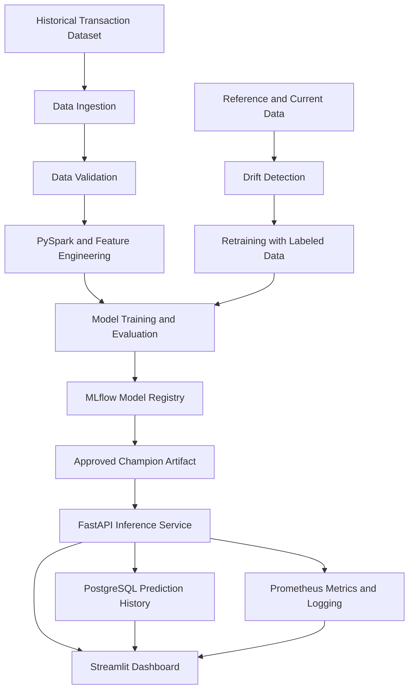

# FraudLens AI

### End-to-End Fraud Detection and MLOps Platform

FraudLens AI is an end-to-end machine learning engineering project designed to demonstrate transaction fraud detection, scalable data processing, model deployment, observability and controlled model lifecycle management.

The platform combines data engineering, machine learning, backend development, cloud deployment and MLOps into a unified fraud detection workflow.

## Project Highlights

- Automated data ingestion, validation and transformation.
- PySpark-based data processing and Parquet storage.
- Random Forest and Logistic Regression classification.
- Feature engineering and decision threshold optimization.
- RESTful inference API using FastAPI.
- API key authentication and request rate limiting.
- Docker-based application packaging.
- GitHub Actions automated testing and CI.
- Interactive Streamlit dashboards.
- PostgreSQL prediction history.
- Prometheus metrics and structured logging.
- Population Stability Index (PSI) drift detection.
- Candidate model retraining and performance screening.
- MLflow model registry, promotion and rollback.

## Technology Stack

| Layer | Technologies |
|---|---|
| Programming | Python |
| Data Engineering | PySpark, Pandas, NumPy, Parquet |
| Machine Learning | Scikit-learn, Random Forest, Logistic Regression |
| Model Management | MLflow, Joblib |
| Backend | FastAPI, Pydantic, Uvicorn |
| Database | PostgreSQL, SQLAlchemy |
| Monitoring | Prometheus, Structured JSON Logging |
| Dashboard | Streamlit, Altair |
| DevOps | Docker, Git, GitHub Actions |
| Cloud | Render, Streamlit Community Cloud |
| Testing | pytest, HTTPX |

## System Architecture



## Machine Learning Performance

The project evaluates classification models using precision, recall, F1 score and average precision rather than relying solely on accuracy.

Historical experimental results:

| Model | Precision | Recall | F1 Score | Average Precision |
|---|---:|---:|---:|---:|
| Logistic Regression | 5.77% | 90.82% | 10.85% | 72.20% |
| Random Forest | 83.16% | 80.61% | 81.87% | 82.31% |

The optimized Random Forest experiment achieved approximately 80.39% precision, 83.67% recall and 82% F1 score at a decision threshold of 0.35 on the corresponding evaluation split.

These results are historical experimental measurements, not guaranteed production performance. Results depend on the dataset, evaluation split and threshold.

## Model Lifecycle Management

The MLflow registry supports three model aliases:

- **Champion:** Model selected for deployment.
- **Candidate:** Newly trained model undergoing evaluation.
- **Previous:** Former champion available for rollback.

Candidate screening requires:

- Precision of at least 70%.
- Recall of at least 70%.
- F1 score of at least 75%.
- Explicit approval before promotion.

Promotion changes the registry alias. Deployment installs the approved model artifact, and rollback restores the previous champion.

## API Endpoints

| Method | Endpoint | Description |
|---|---|---|
| GET | / | API welcome |
| GET | /health | Service readiness |
| POST | /predict | Transaction fraud prediction |
| GET | /model/info | Deployed model information |
| GET | /database/status | Database availability |
| GET | /predictions/history | Stored prediction history |
| GET | /predictions/summary | Prediction summary |
| GET | /monitoring/predictions | Inference monitoring |
| GET | /metrics | Prometheus metrics |

Protected endpoints require API key authentication.

## Getting Started

### Clone the repository

```bash
git clone https://github.com/VishnuVardhan12344/FraudLens-AI.git
cd FraudLens-AI
```

Repository access is required if the repository is private.

### Create a virtual environment

```bash
python3 -m venv .venv
source .venv/bin/activate
```

### Install dependencies

```bash
python -m pip install -r requirements-test.txt
python -m pip install -r requirements-dashboard.txt
```

### Environment configuration

Create a local `.env` file with the required configuration:

```env
FRAUDLENS_API_KEY=replace_with_your_secret
FRAUDLENS_API_URL=http://127.0.0.1:8000
FRAUDLENS_RATE_LIMIT=60
MLFLOW_TRACKING_URI=http://127.0.0.1:5050
```

PostgreSQL integration additionally requires a valid `DATABASE_URL`.

Never commit real credentials to version control.

### Start FastAPI

```bash
PYTHONPATH=src python -m uvicorn fraudlens.api:app \
--host 127.0.0.1 --port 8000
```

API documentation:

http://127.0.0.1:8000/docs

### Start Streamlit

```bash
FRAUDLENS_API_URL=http://127.0.0.1:8000 \
python -m streamlit run dashboard/app.py
```

### Start MLflow

```bash
mlflow server \
--backend-store-uri sqlite:///mlflow.db \
--host 127.0.0.1 \
--port 5050 \
--workers 1
```

### Run automated tests

```bash
DATABASE_URL="" PYTHONPATH=src python -m pytest tests/ -v
```

### Build the Docker image

```bash
docker build -t fraudlens-ai .
```

### Run the Docker container

```bash
docker run -d \
--name fraudlens-api \
--env-file .env \
-e DATABASE_URL= \
-p 127.0.0.1:8001:8000 \
fraudlens-ai
```

## Deployment

Cloud API:

https://fraudlens-ai-ecn5.onrender.com

Interactive API documentation:

https://fraudlens-ai-ecn5.onrender.com/docs

The cloud API uses the model artifact packaged with the repository. Local registry operations do not automatically update the cloud model.

## Monitoring and Observability

The platform includes:

- Request counts and response latency.
- Model prediction counts.
- Fraud prediction rates.
- Average inference latency.
- Prediction failures.
- Rate limit rejection counts.
- Structured request logs.
- Persistent prediction history when PostgreSQL is configured.

## Drift Detection and Retraining

Population Stability Index is used to compare reference and current feature distributions.

Significant drift can trigger a retraining workflow when labeled data is available. Newly trained models are evaluated before registration and require explicit approval before promotion.

Drift detection is demonstrated using historical and simulated distribution shifts. Drift alone does not establish model performance degradation.

## Security

- API key authentication.
- Request rate limiting.
- Input validation.
- Environment-based secret management.
- Exclusion of credentials from version control.
- Restricted local service bindings.
- Model artifact validation.
- Explicit approval before model promotion.

Only trusted model artifacts should be loaded.

## Project Limitations

FraudLens AI is an educational and portfolio engineering project, not a certified banking fraud prevention system.

The model uses anonymized historical credit card transaction features. Production adoption would require independent validation, representative data, stronger authentication, distributed rate limiting, centralized observability, secure model artifact storage and additional governance controls.

The PostgreSQL, MLflow registry and retraining integrations are demonstrated locally. Prediction monitoring does not represent confirmed fraud outcomes unless verified labels are available.

## Future Enhancements

- Kafka-based streaming transaction ingestion.
- Real-time feature computation.
- Distributed model serving.
- Kubernetes orchestration.
- Automated deployment approval workflows.
- Centralized model artifact storage.
- Production-grade drift and performance monitoring.
- Champion-challenger evaluation on independent datasets.

## Author

Vishnu Vardhan Miriyala

Master of Science in Business Analytics — University of North Texas

Interests: Data Engineering, Machine Learning Engineering, MLOps and Applied AI.